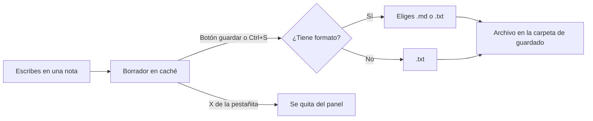

# Notas Escritorio

Tus notas como widget en el escritorio de Windows 11. 
Quedan por debajo de las demás ventanas y nunca tapan la barra de tareas.

---

| Dato | Valor |
|---|---|
| Sistema | Windows 10 / 11 (64 bits) |
| Instalación | Ninguna: un solo `.exe` |
| Formato de las notas | `.txt` (texto plano) y `.md` (con formato) |
| Tecnología | C# · .NET 8 · WPF (sin XAML, todo en `src/Program.cs`) |

## Video

Mira la app funcionando en el PC: [▶️ Ver el video en YouTube](https://youtu.be/bbt7eunLImk)

---

## Características principales

| Área | Qué hace |
|---|---|
| **Widget** | Fijo en el escritorio, debajo de las demás ventanas, solo en el alto libre de la pantalla |
| **Borradores** | Lo que escribes se conserva aunque cierres la app o apagues el PC |
| **Guardado manual** | El archivo solo se crea al pulsar guardar |
| **Formato real** | Negrita, cursiva, tachado, títulos, listas, casillas, enlaces, tablas, fuente y color por fragmento |
| **Notas flotantes** | Una nota se puede sacar del panel como ventana propia y devolverla |
| **Personalización** | 10 temas, color por nota, transparencia del panel y de las notas, ancho ajustable |

## Cómo funciona

- El **punto gris** de la pestañita indica que la nota tiene cambios sin guardar.
- Quitar una nota del panel **no borra** su archivo guardado.

## El panel

### Botones de la ventana (arriba a la derecha)

| Botón | Acción |
|---|---|
| **−** | Deja solo la barra lateral. Otra vez: vuelve al ancho normal |
| **▢** | Ocupa todo el ancho de la pantalla. Otra vez: vuelve al ancho normal |
| **✕** | Cierra la app (las notas se conservan) |

El ancho también se cambia arrastrando el borde interior del panel.

### Barra lateral

| Botón | Acción |
|---|---|
| Tuerca | Menú de opciones |
| Lista | Nueva lista de tareas |
| Abrir | Abrir archivos `.txt` o `.md` |
| H1 | Títulos 1, 2, 3 o texto normal |
| Listas | Viñetas, numerada o casillas |
| **B** / *I* / ~~S~~ | Negrita, cursiva, tachado |
| Enlace | Insertar enlace |
| Fuente | Tipo y tamaño de letra del texto seleccionado |
| A de color | Color del texto seleccionado |
| Tabla | Insertar tabla de 2×2, 3×3 o 4×3 |
| Paleta | Tema del panel |
| **+** | Nueva nota (aparece al final de la lista) |

La barra queda siempre en el lado interior del panel.

### Menú de opciones (tuerca)

| Opción | Para qué sirve |
|---|---|
| Cambiar carpeta de guardado… | Dónde se crean los archivos (por defecto `Documentos\Notas Escritorio`) |
| Abrir carpeta de guardado | Abre esa carpeta en el Explorador |
| Panel a la izquierda / derecha | Lado de la pantalla |
| Transparencia del panel y las notas… | Dos deslizadores independientes (100 % = opaco, texto más nítido) |
| Restablecer el ancho | Vuelve a 360 |
| Iniciar con Windows | Activa o desactiva el arranque automático |
| Ocultar panel / Salir | Esconde el panel o cierra la app |

## Cada nota

| Parte | Elemento | Acción |
|---|---|---|
| Pestañita | Punto gris | Aviso de cambios sin guardar |
| Pestañita | **✕** | Quitar la nota del panel |
| Abajo, izquierda | Guardar | Guarda en la carpeta de guardado |
| Abajo, centro | Paleta | Color de la nota: Blanco, Amarillo, Rosa, Azul, Verde, Lila o Personalizado |
| Abajo, derecha | Ventanita | Sacar la nota del panel, o devolverla |
| Borde inferior | Rayita | Arrastrar para cambiar el alto. Doble clic: alto automático |

- **Reordenar:** arrastra la nota por una zona sin texto y suéltala donde quieras.
- **Sacar del panel:** arrástrala fuera del panel o usa el botón de la ventanita.
- **Nota flotante:** se mueve desde cualquier zona sin texto, se redimensiona por los bordes derecho e inferior o la esquina, y recuerda su posición.
- **Clic derecho sobre el texto:** cortar, copiar, pegar, formato y color.

## Guardar y abrir

| Situación | Resultado |
|---|---|
| Nota sin formato | Se guarda como `Título.txt` |
| Nota con formato | Pregunta: **.md** (conserva negrita, títulos, listas, enlaces y tablas) o **.txt** (texto plano) |
| Nota ya guardada | Guarda los cambios en el mismo archivo |
| Abrir `.md` | Recupera el formato |

> **Nota:** los colores y tipos de letra solo se conservan dentro del panel, no en el archivo.

## Atajos de teclado

| Atajo | Acción |
|---|---|
| `Ctrl+S` | Guardar la nota activa |
| `Ctrl+Shift+S` | Guardar como… |
| `Ctrl+O` | Abrir archivos |
| `Ctrl+K` | Insertar enlace |
| `Ctrl+B` / `Ctrl+I` | Negrita / cursiva |

## Dónde está el `.exe`

| Dónde | Ruta |
|---|---|
| En GitHub | [`NotasEscritorio-v43.exe`](https://github.com/Franciscaii/APP_Notas_Escritorio/blob/main/NotasEscritorio-v43.exe) (raíz del repositorio) |
| En el PC de Francisca | `C:\Users\franc\Documents\Clones GitHub\NotasEscritorio\NotasEscritorio-v43.exe` |

> Descarga el `.exe` desde GitHub con el botón **Download raw file** (o clic derecho → *Guardar enlace como…*). No necesitas nada más.

## Uso

| Paso | Qué hacer |
|---|---|
| 1. Abrir | Doble clic en `NotasEscritorio-v43.exe` |
| 2. Aviso de Windows | Si aparece "Windows protegió tu PC": **Más información → Ejecutar de todas formas** |
| 3. Anclar | Clic derecho en el `.exe` → Mostrar más opciones → **Anclar a la barra de tareas** |
| 4. Icono anclado | Primer clic trae el panel al frente; segundo clic lo manda al fondo |
| 5. Compartir | Basta con enviar el `.exe` |

- Solo puede haber **una copia abierta** a la vez.
- Para cambiar de versión, cierra la app con **✕** y abre el `.exe` nuevo.

## Dónde se guardan los datos

| Qué | Ubicación |
|---|---|
| Archivos guardados | Carpeta de guardado (por defecto `Documentos\Notas Escritorio`) |
| Borradores del panel | `%LOCALAPPDATA%\NotasEscritorio\cache` |
| Configuración | `%APPDATA%\NotasEscritorio\config.json` |

No usa variables de entorno ni conexión a internet.

## Estructura del proyecto

| Ruta | Contenido |
|---|---|
| `NotasEscritorio-v43.exe` | Versión actual de la app. Las anteriores están en el historial de Git |
| `src\Program.cs` | Todo el código |
| `src\NotasEscritorio.csproj` | Proyecto .NET |
| `src\app.ico` | Icono |
| `src\compilar.bat` | Compila el `.exe` |
| `Respaldo\` | Copias de versiones anteriores |

## Compilar

| Paso | Acción |
|---|---|
| 1 | Instalar el SDK de .NET 8: https://dotnet.microsoft.com/download/dotnet/8.0 |
| 2 | Doble clic en `src\compilar.bat` (ejecuta `dotnet publish -c Release`) |
| 3 | El `.exe` queda en `src\salida` |

## Consideraciones importantes

- El `.exe` **no está firmado**: Windows puede mostrar un aviso, y Smart App Control puede bloquearlo.
- Con transparencia menor a 100 % el texto se ve algo menos nítido.
- Cambiar entre opaco y transparente, o entrar y salir del tema **Vidrio**, reinicia la app sola.
